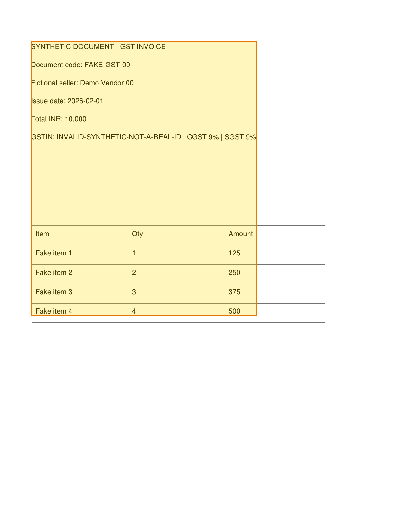

# Unmess

[](https://github.com/DineshDhanoki/unmess/actions/workflows/ci.yml)
[](LICENSE)

**Turn messy PDF pages into inspectable, citable chunks—locally.**

An invoice says the total is **INR 10,000**. But what if a table continues onto the next page, a line was missed, or two tables were joined by mistake? A plausible number is not enough. Someone needs to see the source that produced it.

Unmess is an open-source Python project building that evidence trail. It uses existing parsers, keeps page locations attached to extracted chunks, and tests where document processing fails. The mission is to make private document answers easier to **check**, not merely easier to generate. Today you can run extraction, chunking, provenance, and evaluation code. Private search, an API, and a review UI are future work.

## See the evidence, then try it

This is a real output of the local demo using a **fictional GST-style invoice included in the repository**:



The demo extracts `Total INR: 10,000`, records page 1 as its source, and can render the cited **chunk** on that page. The highlighted area is deliberately broader than the total line; it shows the region represented by the current chunk, not a claim that Unmess identified the exact answer text. The invoice is synthetic. No document is uploaded, and this demo makes no model or network call.

From a fresh clone, install [uv](https://docs.astral.sh/uv/) and Python 3.11 or 3.12, then run:

```bash
git clone https://github.com/DineshDhanoki/unmess.git
cd unmess
uv sync --dev --locked
uv run python -m scripts.demo
```

You should see output like:

```text
Unmess local demo — fictional invoice; no upload or model required
Input: eval/datasets/pdf/synthetic-gst_invoice-00.pdf
Parser: pymupdf
Extracted: Fictional seller: Demo Vendor 00; Total INR: 10,000
Citable chunk: text-9f029e03df396fd9b1da (page 1)
Current scope: extraction, chunking, and source provenance. Search and UI are planned.
```

To save the highlighted preview yourself, run:

```bash
uv run python -m scripts.demo --highlight-output unmess-source.png
```

Open `unmess-source.png` and compare it with the [synthetic source PDF](eval/datasets/pdf/synthetic-gst_invoice-00.pdf). The output path is relative to your current directory and works on macOS, Linux, and Windows. Never commit a real invoice, receipt, ID, or customer document.

## What happens to the document?

```text
Bundled fictional PDF
       ↓  PyMuPDF adapter
Page content with source locations
       ↓  structure-aware chunking
Chunk linked to its source page and region
       ↓  local demo
Extracted total + optional highlighted preview
```

That is the path exercised by the demo. Other adapters, page-quality signals, table stitching, and synthetic evaluation code are also in the repository; they are not all exercised by this one command. The [architecture](ARCHITECTURE.md) explains how the pieces fit together, and the [evaluation notes](EVAL.md) explain what the current experiments can and cannot show.

## The project, honestly

| Available in this repository | Still to build |
| --- | --- |
| PyMuPDF adapter, optional Docling and local vision adapters, page routing and quality signals | A complete ingestion service and background jobs |
| Structure-aware chunks, conservative table stitching, source page and region records | Hybrid retrieval, answer citations, and local reranking |
| Synthetic corpora, evaluation harnesses, and development reports | Review UI, MCP tools, and real-document validation results |

The [roadmap](ROADMAP.md) describes the planned sequence. Measurements so far use synthetic data and have [known limitations](EVAL.md); they are not production accuracy or speed claims. Optional parsers and local models require extra setup. The demo above deliberately avoids them.

## Build it with us

You do not need to own the whole architecture to make Unmess better. Pick a problem that matches the kind of work you enjoy:

| If you enjoy… | Start here | What your contribution would add |
| --- | --- | --- |
| Explaining technical ideas in plain language | [Explain five Unmess terms beside the demo (#18)](https://github.com/DineshDhanoki/unmess/issues/18) | Help a newcomer understand chunks, provenance, and review without reading the architecture first. |
| Designing tricky test cases | [Add synthetic table hard negatives (#3)](https://github.com/DineshDhanoki/unmess/issues/3) | Catch cases where unrelated tables could be joined by mistake. |
| Evaluation and failure analysis | [Test the review gate on more bad pages (#9)](https://github.com/DineshDhanoki/unmess/issues/9) | Show which synthetic failure types the current gate catches or misses. |

Check the issue before starting in case someone has claimed it. Comment there to coordinate, then use the [first contribution guide](CONTRIBUTING.md) for setup and PR steps. We review code and evidence together. If you have a question or a story about an answer you could not verify, join the [welcome discussion](https://github.com/DineshDhanoki/unmess/discussions/20).

The project especially welcomes people interested in document parsing, Python, evaluation, privacy, and bilingual or region-specific documents. You do **not** need to supply real documents. Every shared fixture must be synthetic.

## Deeper setup

The normal contribution checks are `make lint`, `make format-check`, `make typecheck`, and `make test`. The reproducibility tests need a pinned Noto Sans Devanagari font; run `bash scripts/pull_font.sh` first in a Bash environment. Docker is only needed for infrastructure work: `make up` starts Qdrant and Redis, **not** a working Unmess app. See [CONTRIBUTING.md](CONTRIBUTING.md) for the exact path and [EVAL.md](EVAL.md) for evaluation rules.

Apache License 2.0. See [LICENSE](LICENSE).
